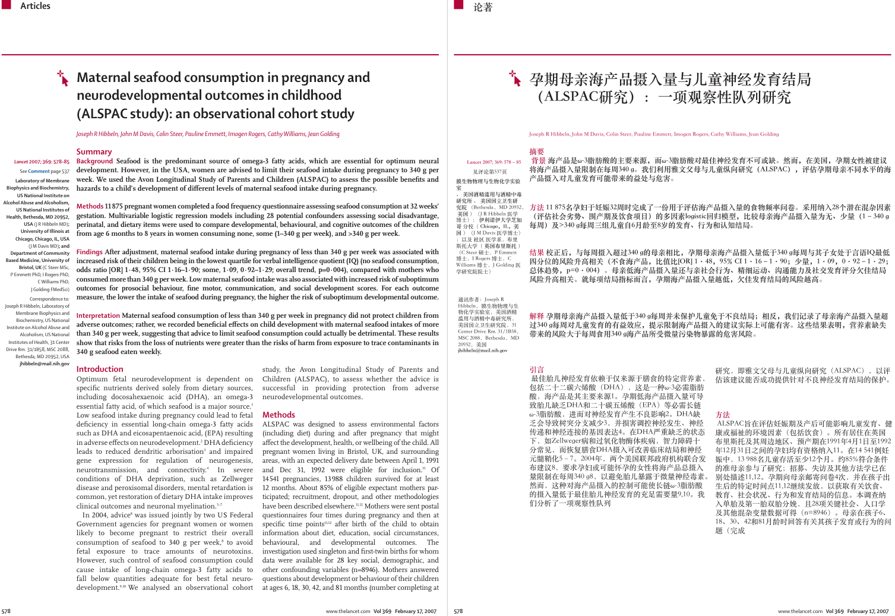
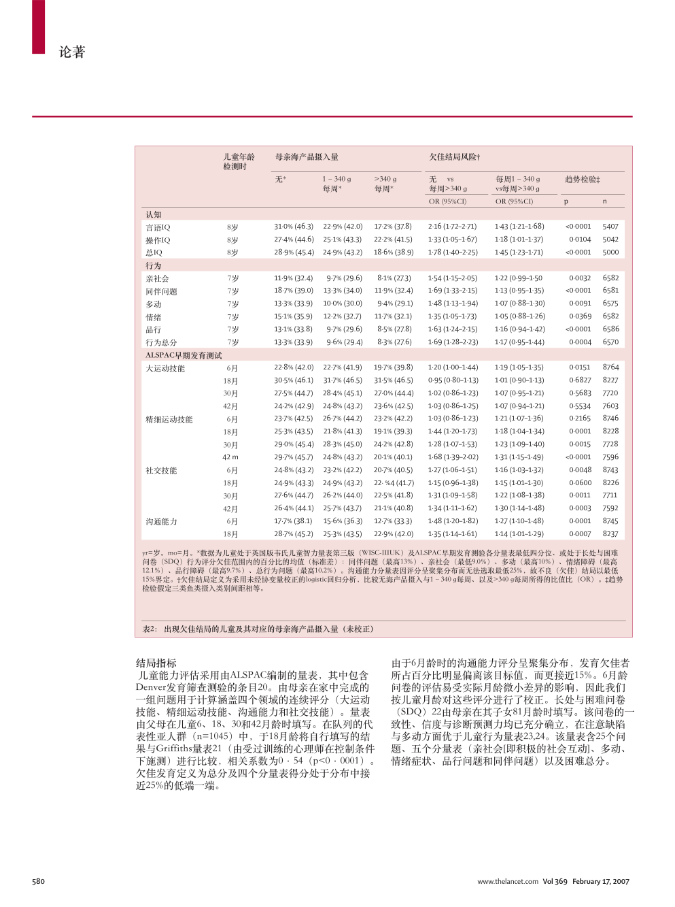

# translate-paper

Translate an academic paper PDF into Chinese in place. The two-column text, the table rules, the figure captions, the fonts and the colours all stay where the typesetter put them. The agent's own model does the translating, so there is no API key, no translation service, and no per-page bill.

```
paper.pdf ─extract_units→ units.json ─split_lanes→ N lanes ─subagents→ trans_*.json
        └─merge_translations(gate)→ translations.json ─fill_units→ paper.zh.pdf
        └─check_residual(gate) + audit_layout(gate) + make_dual(bilingual) + vision review
```



*Page 1 of a real 8-page Lancet paper (ALSPAC maternal seafood study, 2007), paired in `--mode column`.*

## Install

```bash
npx skills add zyf2492313716-cloud/translate-paper
```

Needs Python 3 with [PyMuPDF](https://pypi.org/project/PyMuPDF/) (`pip install pymupdf`). `fontTools` is optional; it only pulls a single face out of a macOS `.ttc`. The inserted text prefers a serif CJK face, in order: Source Han Serif or Noto Serif CJK on the system, a face extracted from `Songti.ttc`, a sans face, then PyMuPDF's built-in CJK.

## Why paragraph blocks instead of spans

Take the direct route of extracting every text span, translating it and writing it back, and you get fragments. On the Lancet paper used here, 637 of 1365 spans are shorter than 15 characters, and the typesetter has already cut sentences across them. This skill works on paragraph blocks, and only drops to cell granularity where a block really is a table row.



## Gates

Every stage ends in a mechanical check. These are the ones that can fail a build:

| gate | catches |
|---|---|
| `MISS` | a unit nobody translated (a lane died) |
| `LATIN` | English left in a translation that the source unit never contained |
| `DRIFT` | a lane inventing its own synonym for a glossed term, or the same source string getting two different renderings across lanes |
| `NUMBER` | a decimal or integer dropped while translating |
| `LEFTOVER` | source letters surviving inside a replaced rectangle |
| `OVERFLOW` | replacement running past its rectangle |
| `CLIPPED` | a deliberately-kept cell eaten by a neighbour's redaction |
| `BIoU` / `ANCHOR` | block structure drifting page by page, replacement no longer starting where its block started |
| `SMALL` / `RULES` / `COLLIDE` | text below the readable floor, table rules lost to redaction, replacement overlapping kept text |

Each gate was run against a deliberately broken input to confirm it can go red. A green gate that cannot fail is not a gate.

## Measured against zotero-pdf2zh

Same 8-page paper, pdf2zh_next 2.8.2 with DeepSeek on one side, this skill on the other:

| | zotero-pdf2zh | this skill |
|---|---|---|
| numeric tokens preserved | 539/551 (12 had `·` normalised to `.`; footnote `12.1%` typeset as `12 1%`) | 551/551 |
| table unit language | mixed (`8 yr` kept, `18个月`/`30 月`/`42 月` coexisting) | uniform |
| `yr=years. mo=months.` | rendered as "岁=年，月=月" | rendered correctly |
| reference list | translated, so citations stop being searchable | kept in the source language |
| bilingual output | yes | yes (`--mode page` or `--mode column`) |
| auto glossary | yes, 651 terms | you write `glossary.md` first; the gate enforces it |
| cost | API key + tokens | none |
| wall time | ~14 min | ~10 min with 6 parallel lanes |

## What the vision review caught

The first build passed every gate above. A vision-review subagent still found five defects on it, and each one is now fixed in code rather than patched in the PDF:

- A meaning-level escalation. "Shows no evidence that consumption ... has an adverse effect" (absence of evidence) had become "显示…并无不良影响" (proof of no harm). The checklist now names this failure mode.
- Whole paragraphs printed in the wrong ink. The extractor took a block's colour from its first span, which is the red run-in label, so black body text was reprinted in journal red. Body colour and label colour are now stored separately, each the dominant colour of the spans carrying it, classified by ink and never by weight.
- A bold body misread as a heading. The Lancet summary box sets its entire body in a bold face, so the extractor marked a random body word ("week.") as a run-in label and the translator copied it faithfully. A block whose every span is bold now carries a block-level `bold` flag instead of per-span markers, and the typesetter keeps face and ink separate, so a forced-bold body cannot turn red.
- Table headers quietly losing their weight, because bold cells were rendered from translation text that carries no bold markers. Fixed by honouring the cell's own bold flag.
- A Chinese word cut in half across a column break, which English tolerates and Chinese does not. Fixed by rewording the sentence boundary.

The next paper inherits all of these as code and checklist entries.

## Bilingual output

```bash
python scripts/make_dual.py paper.pdf paper.zh.pdf paper.dual.pdf --mode column
```

`--mode column` crops each column and pairs it with its own translation, which keeps the text at 100% on two-column journals. `--mode page` puts whole pages side by side, the form zotero-pdf2zh emits. Pages whose title, summary box or a wide table straddles the gutter fall back to whole-page pairing instead of being cut mid-word.

## Limits

- Scanned PDFs have no text layer. OCR first.
- Rotated axis labels inside figures stay in the source language.
- The bilingual version composes two PDFs side by side. It is not one page carrying both languages.
- Lanes run as parallel subagents, so `glossary.md` is the only thing keeping terminology consistent. Write it before splitting lanes.

This is built for reading a paper you have to understand, fast. It is not a substitute for a professional translation.

## License

MIT
