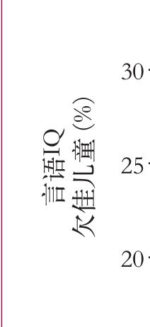

# translate-paper

把学术论文 PDF 翻译成中文，版式原地不动。双栏正文、表格线、图题、字体、颜色，都在排版师原本放的位置上。翻译由 agent 自己的模型完成，不需要 API key，不需要翻译服务，不按页计费。

```
paper.pdf ─extract_units→ units.json ─split_lanes→ N lanes ─subagents→ trans_*.json
        └─merge_translations(gate)→ translations.json ─fill_units→ paper.zh.pdf
        └─check_residual(gate) + audit_layout(gate) + make_dual(bilingual) + vision review
```


*一篇真实的 8 页 Lancet 论文（ALSPAC 母亲海产品摄入研究，2007）第 1 页，`--mode column` 模式。*

## 安装

```bash
npx skills add zyf2492313716-cloud/translate-paper
```

需要 Python 3 和 [PyMuPDF](https://pypi.org/project/PyMuPDF/)（`pip install pymupdf`）。`fontTools` 可选，只用于从 macOS 的 `.ttc` 里抽取单个字体。写入的中文优先使用衬线字体，顺序是：系统里的思源宋体或 Noto Serif CJK，从 `Songti.ttc` 抽取的字体，无衬线字体，最后是 PyMuPDF 内置 CJK。

## 为什么按段落块而不是按 span 做

最直接的做法是把每个文本 span 抽出来、翻译、写回去，得到的是碎片。这里用的那篇 Lancet 论文里，1365 个 span 中有 637 个短于 15 个字符，句子早就被排版师切碎了。本技能以段落块为单位，只在区块确实是表格行时才下沉到单元格粒度。


图内竖排的坐标轴标签按原来的旋转方向重画，竖排仍然是竖排：



## 门禁

每个阶段结尾都有机械检查，下列任何一项不过都会让构建失败：

| 门禁 | 拦住什么 |
|---|---|
| `MISS` | 没人翻译的单元（某个子代理挂了） |
| `LATIN` | 译文里留下原文单元里从未出现过的英文 |
| `DRIFT` | 某条车道自造术语译名，或同一句原文在不同车道得到两种译法 |
| `GLUE` | 出现原文里根本没有的数字串，而它能拆回原文中的两个数字——即上标引文号粘在了前面的数字上（`ICD-11` + 文献 20 → `ICD-1120`） |
| `SUP` | 译文丢掉或凭空加了 `{{s}}` 引用标记（前者等于少了一条引文） |
| `TERM` | 某单元原文两次以上用到某个受控术语，而它的译文一次都没有用规定译名（按单元判，按车道判会被复合词的子串蒙过去） |
| `NUMBER` | 翻译过程中丢掉的小数或整数 |
| `LEFTOVER` | 被替换掉的矩形框里残留原文 |
| `OVERFLOW` | 译文溢出原矩形框 |
| `CLIPPED` | 刻意保留的单元格被相邻区域的擦除吃掉 |
| `BIoU` / `ANCHOR` | 逐页块结构漂移，替换文本不再落在原块起点 |
| `SMALL` / `RULES` / `COLLIDE` | 字号低于可读下限，表格线被擦除丢失，译文与保留文字重叠 |
| `DROPPED` | 被擦除后缩到 0.5x 也画不回去的单元；此时整个流程以退出码 1 收场 |

每个门禁都对着一个故意破坏的输入跑过，确认它能判红。不会变红的绿灯不算门禁。

## 与 zotero-pdf2zh 的实测对比

同一篇 8 页论文，一边是 pdf2zh_next 2.8.2 + DeepSeek，一边是本技能：

| | zotero-pdf2zh | 本技能 |
|---|---|---|
| 数字 token 保留 | 539/551（12 个 `·` 被归一成 `.`；脚注 `12.1%` 排成了 `12 1%`） | 551/551 |
| 表格单元语言 | 混杂（`8 yr` 保留，`18个月`/`30 月`/`42 月` 并存） | 统一 |
| `yr=years. mo=months.` | 译成"岁=年，月=月" | 正确译出 |
| 参考文献表 | 翻译了，引文从此搜不到 | 保持原文 |
| 中英对照 | 有 | 有（`--mode page` 或 `--mode column`） |
| 自动术语表 | 有，651 条 | 自己先写 `glossary.md`，门禁负责强制执行 |
| 成本 | API key + token 费用 | 无 |
| 耗时 | 约 14 分钟 | 约 10 分钟（6 条并行车道） |

## 视觉复查抓到了什么

第一个构建通过了上面所有门禁，视觉复查子代理仍在它身上发现五处缺陷，每一处都改在代码里，没有一处是直接打补丁到 PDF 上：

- 语义升级。"Shows no evidence that consumption ... has an adverse effect"（没有证据表明有不良影响）被译成了"显示…并无不良影响"（证明无害）。复查清单现在点名了这一类错误。
- 整段文字印错了颜色。提取器把区块颜色取自第一个 span，而那是红色的段首标签，于是黑色正文被重新印成了期刊红。现在正文颜色和标签色分开存，各取承载它的 span 中的主导色，按墨色判断，绝不按字重判断。
- 粗体正文被误当成标题。Lancet 摘要框整个正文都是粗体，提取器于是把一个随机正文词（"week."）标成了段首标签，翻译忠实地照抄。现在整块皆粗的区块带块级 `bold` 标记而不是逐 span 标记，排版时字重和墨色分离，强制加粗的正文不会变红。
- 表头悄悄丢了字重，因为粗体单元格是从不带粗体标记的译文渲染的。改为尊重单元格自己的粗体标记。
- 一个中文词在分栏处被切成两半，英文经得起这么切，中文经不起。改写句界解决。

下一个论文会把这五条全部作为代码和清单条目继承下去。

## 中英对照输出

```bash
python scripts/make_dual.py paper.pdf paper.zh.pdf paper.dual.pdf --mode column
```

`--mode column` 把每一栏裁出来与它自己的译文配对，双栏期刊上的文字保持 100% 字号。`--mode page` 是整页对整页，即 zotero-pdf2zh 输出的形态。标题、摘要框或宽表跨沟的页面退化为整页配对，不会在词中间被切开。

## 边界

- 扫描件没有文字层，先过 OCR。
- 轴对齐的旋转文字（90°/270°，也就是常见的坐标轴标签）照原方向翻译并重画；真正斜排的文字保持原文，并在 `skipped` 里记为 `oblique`。
- 中英对照版是两个 PDF 并排合成，不是一页同时承载两种语言。
- 各车道是并行子代理，`glossary.md` 是保持术语一致的唯一手段。分车道之前先写好它。

这个技能为快速读懂一篇必须读懂的论文而做，不是专业翻译的替代品。

## License

MIT
